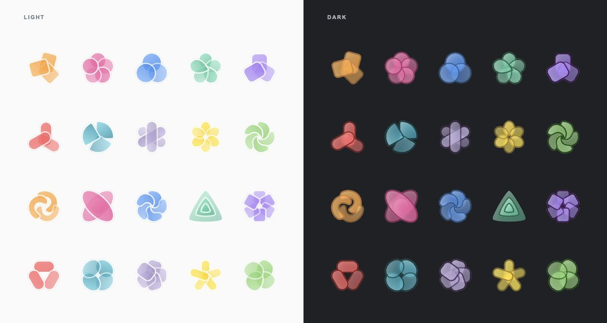

# Iconloom

An Agent Skill that creates coherent SVG icon packs from your subjects, colors and visual references, with matching light and dark variants.



## Install

Place this repository in an `iconloom` folder inside your agent's skill directory. Requires Python 3.10+ and an agent that can read skills, write files and run Python.

## Use

```text
Use $iconloom to create 12 icons for a gardening app.
Use a soft mint palette, rounded forms and subtle shading.
Design for 16px and 32px.
Deliver light/dark SVG pairs, source specs and a preview.
```

Choose layered, outline or duotone styling, with your own colors or a visual reference.

[Abstract examples](examples/abstract/svg/) · [Object examples](examples/svg/) · [Authoring guide](references/packs.md)
